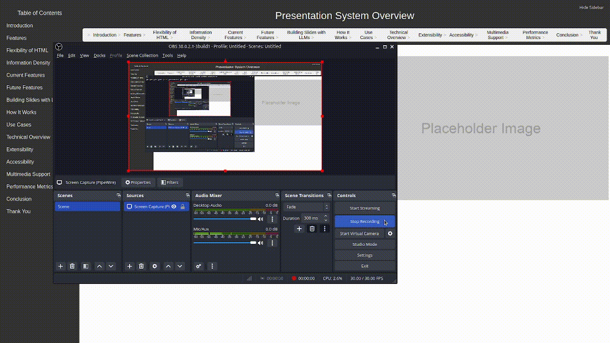

# HTML-Powered Slides

A lightweight Python generator for themed, interactive HTML presentations. Presentations are described with YAML or JSON and rendered as static HTML, CSS, and JavaScript that can be opened in a browser.



## Status

This is a small experimental tool, not a hosted presentation service. It supports nested folds, table-of-contents navigation, breadcrumbs, several bundled themes, images, and structured row/column layouts.

Configuration content may contain raw HTML and is therefore treated as trusted input. Do not generate presentations from untrusted configuration files.

## Install

Python 3.10 or newer is required.

```bash
git clone https://github.com/marcCarnovale/HTML_Powered_Slides.git
cd HTML_Powered_Slides
python -m venv .venv
source .venv/bin/activate
python -m pip install -e .
```

## Generate the example

```bash
html-powered-slides --config examples/minimal.yaml --theme dark
```

The generated presentation is written beneath `output/` unless `--output_dir` is supplied. Open the generated HTML file directly in a modern browser.

Available themes are `dark`, `blue`, `forest`, and `seafoam`.

## Configuration

The smallest useful configuration is:

```yaml
title: Example
slides:
  - title: Introduction
    content:
      - <p>Ordinary HTML content.</p>
    folds:
      - title: Detail
        content:
          - <p>Progressively revealed detail.</p>
```

See [`examples/minimal.yaml`](examples/minimal.yaml) and the generated demonstration for a larger vocabulary of layouts.

## Development

```bash
python -m pip install -e '.[dev]'
pytest
ruff check .
```

Generated presentations and Python caches are intentionally excluded from version control.

## Limitations

- Raw HTML is not sanitized.
- Browser behavior has not been exhaustively tested across engines or assistive technologies.
- There are no validated performance or maximum-presentation-size guarantees.
- The project currently has no explicit reuse license; copyright remains with the relevant authors.
